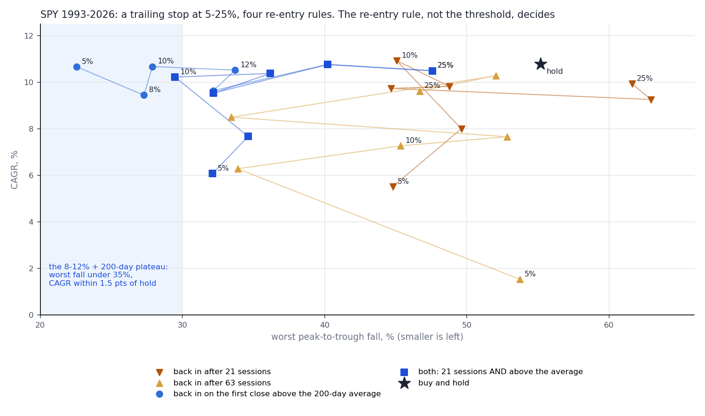
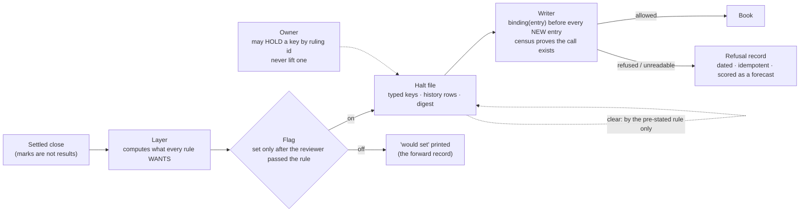
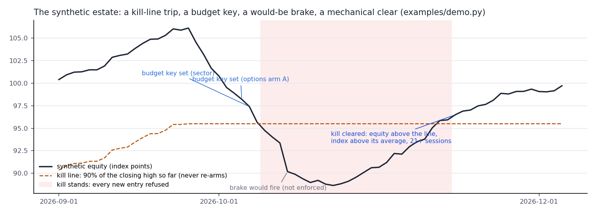

# risk-gate

[](https://github.com/jarvisss007/risk-gate/actions/workflows/ci.yml)

**A risk layer the agents cannot talk their way around.**
After the worst day of a paper-only research estate run by AI agents, its operator asked for a stop loss, for shorts
when the market falls, and for the agents to "make it positive". The data said no to the first, no to the second and
cannot do the third. What got built instead is here: one halt file that every desk's writer must read before a new
entry, keys that set and clear by rules written down in advance, a reviewer agent that blocked three of four proposed
rules, and a human who decides at the gates and nowhere else.



## What happened, in six lines

1. **The ask.** Thu 2026-10-22 the estate (about eight desks, each run by agents, all paper) had its worst day:
   **−4.6%** on a day SPY fell 1.2%. The operator asked for a −3% stop, for the agents to short when the market falls, and
   to make the account positive.
2. **The data said no to the 3%.** On SPY 1993–2026 a 3% trailing stop turns **10.8%/yr into 3.4%/yr** (re-entering
   after 21 sessions) and still falls 35% at worst. After a −3% day SPY is up **65%** of the time over the next 21
   sessions, which is what it does after *any* day (65.8%). Selling the close of a bad day buys nothing.
3. **No market hedge would have helped.** SPY explains **3.4%** of the account's daily P&L (beta 0.50, n=34);
   semiconductors 7%. Two of its three worst days were flat-SPY days. The risk was single names and option arms, and
   only size protects against that.
4. **The re-entry rule decides, not the threshold.** Re-entering after a fixed number of sessions walks straight back
   into 2000–02 and 2008. Re-entering on the first close above the 200-day average, at an 8–12% stop, is one plateau:
   **CAGR 10.7% vs 10.8% hold, worst fall −27.9% vs −55.2%**, and the worst fall is cut in both halves of the sample.
5. **A reviewer agent passed one rule and blocked three.** PASSED: the 10% kill line that had been pre-registered a
   week earlier, with that re-entry rule. BLOCKED: a −3% brake, a 200-day regime gate, and per-desk budgets. Its words
   are [below](#the-reviewers-verdicts). The operator then made the budget decision himself the next morning, in two
   words, and at that day's settled close the layer set five budget keys for desks and arms over their 8% ceiling.
6. **The same night the reviewer found a measurement artefact.** Option structures counted at full delta notional with
   no cap at their maximum loss read net exposure as **211%** of equity. Capped at max loss, **113%**: still over the
   band, which is the honest finding. The fix went through the same reviewer as a versioned change to the pre-registered
   measure, and the old reading kept printing beside the new one.

**Why this is in a portfolio.** The agents did not get a prompt saying "be careful". They got a file. A rule that lives in
a prompt binds only while the model remembers it; a rule that lives where the agent *writes* binds every time. Every
mechanism here is the second kind: the gate is a function call the writer cannot skip without failing a static census,
an unreadable file refuses rather than assumes, a refused entry is recorded and later scored, and the only human move
the file accepts is one that makes it stricter. Swap "trading desk" for "dispatch agent" or "pricing agent" and the
layer is the same.

## The gate



| Role | What it is | What keeps it honest |
|---|---|---|
| Orchestrator | A Claude Code session that ran the night's research and built the layer | Every rule it proposed went to the reviewer before its flag was set; three of four did not pass |
| Reviewer | A `prereg-reviewer` subagent with read-only tools (Read, Grep, Glob, Bash) and an adversarial brief | Returns a verdict and reasons, never an edit; its quoted verdicts are in [docs/reviewer_verdicts.md](docs/reviewer_verdicts.md) |
| Layer | Python, runs once per *settled* close | Computes what every rule wants whatever its flag says; moves a key only behind a flag; never overwrites a file it cannot read |
| Halt file | One JSON file: `halted` keys, `history` rows, a digest over both | A key changes only through a history row; a hand edit fails the digest and refuses like a missing file |
| Desk writers | One per desk, the only path to each book | Each calls the gate before a new entry; a static census (`riskgate census`) proves the call is there; refusals are recorded, not dropped |
| Owner | Me | Asked for the 3%; withdrew it myself when the grid came back; made the sizing ruling in my own words, recorded under its own id |

I built this with Claude Code for **the Firm**, my paper-only research operation. It never trades; nothing here is a
trading product, a return source or advice.

## Timeline (Pacific time)

| When | What |
|---|---|
| Thu 10-22, close | The account's worst day: −4.6% on a day SPY fell 1.2%; two earlier worst days had been flat-SPY days |
| ~20:40 | The ask: a −3% stop, shorts when the market falls, "make it positive" |
| evening | The grid (SPY 1993–2026, 7 stops x 4 re-entry rules, both halves): the re-entry rule decides; 3% ruled out; the operator withdrew the 3% himself. The account's daily P&L against SPY (R² 3.4%) and semis (7%): a market hedge removes almost none of its variance |
| night | Four rules put to the reviewer as a versioned change to the pre-registered layer: kill line **PASS** (conditions met in the enforcing commit); brake, regime gate, budgets **BLOCK**. The kill line enforced from the next settled session; every desk writer given the read; the gate census made a standing check |
| night | The reviewer finds the exposure artefact (211% → 113% bounded). Found and recorded as a defect; not fixed that night |
| Fri 10-23, ~08:00 | The operator answers the budget escalation: "budgets on". His sizing ruling, under its own id. The bounded exposure reading is proposed as v2 of the measure, goes to the reviewer (which escalates the question of which reading a rule is judged on), and he rules: judged on v2 from that date, v1 printed beside it until the phase review, nothing back-filled |
| Fri 10-23, after the close | First enforcing run: five `budget:<desk>` keys set for desks and arms over 8% of equity at risk. Brake and regime gate print what they would have done; the kill line prints its cushion |

## The reviewer's verdicts

| Rule | Verdict | In its words |
|---|---|---|
| 10% kill line + mechanical re-entry (equity back above the line, index above its 200-day average, ≥ 21 sessions; the high never re-arms) | **PASS** with conditions | the third re-entry condition to be stated everywhere; the grid cell cited; the grid's high-water re-arm disclosed |
| −3% brake, two sessions | **BLOCK** | "reinstates a mechanism already ruled out… he withdrew the 3% himself… the forward record is the only record, and there is none" |
| 200-day regime gate, new longs only | **BLOCK** as enforcement; shadow-count it | "the evidence is SPY-on-SPY… SPY explains ~3% of the firm's daily variance… authority for the concept, not for SMA200 / month-end / longs-only" |
| Per-desk 8% / sector 25% budgets | **BLOCK**; escalate to the owner | "four of twenty sessions cannot satisfy [the pre-stated review gates]… this is his sizing ruling, not an enforcement" |

The blocked rules were still built. Their flags are off, and every session the layer prints what each would have done.
That record of would-fires is the forward record the reviewer said did not yet exist; when enough of it exists, the
rule can be judged on it. The brake would have fired on the worst day.

## Four of the estate's house laws, where they bit this week

The estate keeps a short list of mechanisms that have each cost it something once. Four of them are the whole of this
repo.

- **A claim recorded before it is true.** A kill line had been computed and shown as OK/TRIPPED every session for a
  week. No desk read it. "The estate has a kill line" was a sentence in a report, not a fact about the writers. The fix
  was not a stronger sentence; it was a function call in every writer and a census that fails when one is missing.
- **The unwritten gate.** A rule that lives where the actor *reads* binds only while the actor remembers; the place to
  put a rule is where the actor *writes*. `gate.admit()` is the one path to every book. The three attempts to get around
  it in `examples/walkthrough.sh` are all refused by code, not by instruction.
- **A mark is not a settlement.** The layer runs once per settled close, never on a live mark; the exposure artefact was
  a reading that mistook a sensitivity (delta notional) for a loss bound (max loss). Both readings now print, versioned,
  and which one a rule is judged on is a dated ruling.
- **A refusal is a forecast.** "Not now" is a claim about the entry, and claims get graded. Every refused entry is dated
  and scored at a fixed horizon: did it go on to win or lose? A gate whose refusals mostly looked protective is doing
  work; one whose refusals mostly cost return is a tax. Either is a finding.

## The numbers (public data only)

SPY adjusted daily closes 1993-01-29 to 2026-10-16, a trailing stop of X% off the equity high, exit at that close,
0.10% per side; halves split at 2010. The full table is [`results/stop_rule_grid.json`](results/stop_rule_grid.json);
`python -m riskgate grid --download SPY --end 2026-10-17 --compare results/stop_rule_grid.json` reproduces 28 of its
29 cells to four decimals from a fresh download ([`results/stop_rule_grid_yfinance_2026-10-24.json`](results/stop_rule_grid_yfinance_2026-10-24.json));
the 5%/SMA cell fires 93 times instead of 94 because the two price series differ in the sixth decimal and that cell
sits on a knife edge, which is the point about the most-fitted cell.

| Rule | CAGR | worst fall | fires | 1993–2009 | 2010–2026 |
|---|---|---|---|---|---|
| Buy and hold | 10.8% | −55.2% | 0 | 7.6% / −55.2% | 14.0% / −33.7% |
| 3% stop, back in after 21 sessions | **3.4%** | −35.2% | 171 | 1.7% / −35.2% | 5.0% / −19.9% |
| 10% stop, back in after 21 sessions | 10.9% | −45.1% | 31 | 8.2% / −45.1% | 13.6% / −26.2% |
| 10% stop, back in after 63 sessions | 7.3% | −45.3% | 26 | 4.4% / −45.3% | 10.1% / −24.6% |
| **10% stop, back in above the 200-day average** | **10.7%** | **−27.9%** | 23 | 10.8% / −24.3% | 10.4% / −27.9% |
| 10% stop, both (21 sessions and above the average) | 10.2% | −29.5% | 20 | 9.7% / −26.5% | 10.7% / −29.5% |
| 8% stop, above the average | 9.4% | −27.3% | 40 | 9.7% / −23.9% | 9.1% / −27.3% |
| 12% stop, above the average | 10.5% | −33.7% | 15 | 10.8% / −25.9% | 10.1% / −33.7% |
| 5% stop, above the average (best ratio, 94 fires: the fitted cell) | 10.7% | −22.6% | 94 | 10.7% / −22.6% | 10.5% / −19.4% |

The 10% was chosen a week before the grid was run, not fitted to it; it sits inside the plateau. The rule costs about
3.6 points a year in the 2010–26 bull half and earns about 3 points a year in 1993–2009. It buys a smaller worst fall,
not a higher return.

After a −3% day (103 of them): SPY is up 65.0% of the time 21 sessions later, mean +1.9%; after any day, 65.8% and
+1.0% ([`results/after_3pct_day.json`](results/after_3pct_day.json)). The 3% cells are in
[`results/stop_rule_3pct.json`](results/stop_rule_3pct.json).

The account statistics (−4.6% vs −1.2%; R² 3.4% on SPY and 7% on semis at beta 0.50, n=34; two of three worst days on
flat-SPY days) are from the estate's own daily record and are quoted as percentages only.

## The measurement artefact

Net exposure was read as the sum of each position's delta notional times its beta, over equity. For a stock that is
the right sensitivity. For a short put that has gone deep in the money, delta is near one, so the reading carries 100
times spot of "long exposure" per contract while the most the structure can lose is fixed by its strikes. Over a book
of such structures the reading more than doubled the true loss bound: 211% of equity against a band of −30% to +60%.

`riskgate/exposure.py` keeps both readings as versions of one measure: v1, the sensitivity, unbounded; v2, each
defined-risk structure capped at its maximum loss and every beta clipped to a stated range, with the capped and clipped
names listed. Neither replaces the other. The test suite plants a deep-in-the-money structure and shows v1 at 215% and
v2 at 104% of equity on synthetic numbers. In the estate, v2 read 113%: still over the band. A measure that flattered
the book was not the finding; the finding was that the book was over the band either way.

## Run it

Python 3.9+, numpy, pandas, matplotlib; yfinance only for the SPY download; pytest for the tests.

```bash
pip install -r requirements.txt
python -m pytest -q                                   # 17 tests, ~1 second
python examples/demo.py                               # the layer on a synthetic estate, 67 sessions, ~2 seconds
bash examples/walkthrough.sh                          # the demo, then three ways around the gate, all refused
python -m riskgate grid --download SPY --end 2026-10-17 --compare results/stop_rule_grid.json   # reproduce the SPY table
python -m riskgate after-drop --download SPY          # what SPY does after a -3% day
```

`examples/demo.py` prints the sessions on which a key moved or a refusal changed:

```
session       equity     line    dd%  keys moved / entries refused
2026-10-06     98.21    95.50  -7.45  SET budget:options arm A: options arm A at 9.40% of equity at risk > 8% ceiling
                                     refused: options arm A long debit CCC <- budget:options arm A
2026-10-07     97.40    95.50  -8.21  SET budget:sector:semiconductors: sector semiconductors at 27.50% of equity at risk > 25% cap
2026-10-09     94.76    95.50 -10.69  SET kill: drawdown -10.69% from the HWM
                                     refused: insider desk long stock AAA <- kill; fundamentals desk long stock BBB <- kill; pattern desk short stock EEE <- kill; options arm A long debit CCC <- kill; options arm B long credit DDD <- kill
2026-10-12     94.03    95.50 -11.38  CLEARED budget:options arm A: back inside | CLEARED budget:sector:semiconductors: back inside
2026-10-14     90.19    95.50 -15.00  brake NOT ENFORCED: would set until 2026-10-16 (day return -3.40%)
2026-10-30     90.67    95.50 -14.55  regime NOT ENFORCED: would set
2026-11-13     96.49    95.50  -9.07  CLEARED kill: re-entry rule met

67 sessions: 207 entries admitted, 128 refused and recorded; 3 keys set, 3 cleared, every move by a rule
refusals as forecasts at 10 sessions: 128 of 128 scored, 41 looked protective (32%) ...
```

The kill key stood 24 sessions. Equity was back above the line on 11-11 and the key did not move; the index crossed its
average on 11-13, the 21-session count had passed on 11-09, and only then did it clear. Nothing was sold at any point:
the layer gates entries, never exits.



`examples/walkthrough.sh` then tries to get around the gate three ways:

```
== 1. a writer that skips the read: copy a desk writer and remove its gate call
MISSING  .../rogue_writer.py:book  book() does not call the gate (.admit/.binding) through riskgate
2 of 3 writers gated
   (refused: exit 2 - a writer without the read never passes the census, so the suite fails before it ships)
== 2. the halt file is deleted: does a quiet morning follow?
REFUSED: pattern desk short stock EEE: UNREADABLE: halts.json could not be read (FileNotFoundError ...); REFUSING every new entry rather than assume no halt
== 3. a key is lifted by hand: edit the JSON and delete the kill key
REFUSED: insider desk long stock AAA: UNREADABLE: halts.json was edited outside the layer (digest mismatch): `kill` was set 2026-12-07 by ruling:RG-DEMO and is gone with no clear row: a review may hold a halt longer, never lift it earlier. A human change is a history row with a ruling id: `riskgate ruling --id <RULING-ID> set|hold <key>`. ...
REFUSED: a ruling may set or hold a key; it never clears one ('clear')
```

## Use it on your own estate

```python
from riskgate.gate import Gate
from riskgate import layer
from riskgate.halts import HaltFile

# every writer, before it appends a NEW entry to its book:
gate = Gate('halts.json', 'refusals_insider.csv')
allowed, refused = gate.admit('insider desk', candidates, today=session, writer='insider_writer.py')
book.extend(allowed)                       # the refused ones are already in the dated record

# once per settled close, the layer (flags default to the state in this case study: kill + budgets on, brake + regime off):
layer.close(HaltFile('halts.json'),
            layer.SessionInputs(session, equity_curve={...}, index_closes={...},
                                desk_risk={'insider desk': 9.1, ...}, sector_risk={'semiconductors': 26.0, ...}),
            layer.Policy(kill_drawdown_pct=10, kill_reentry_sessions=21, sma_window=200, desk_ceiling_pct=8))
```

```bash
python -m riskgate census writers/insider.py:book writers/options.py:book     # exit 2 if any writer lacks the call: put it in CI
python -m riskgate ruling --halts halts.json --id RG-012 hold kill --session 2026-11-02 --reason "review: wait for month-end"
python -m riskgate verify --halts halts.json                                  # digest and provenance of every key
```

Entries are dicts: `desk`, `side` (`long`/`short`), `structure` (`stock`/`debit`/`credit`/…), optional `arm`,
`sector`, `ticker`. A short, or a defined-risk debit structure, passes the regime key; nothing passes kill, brake or an
unreadable file. The session calendar is a seam (`riskgate/calendar.py`): plug your exchange's holidays in.

## What this is not

- **Not a return source, and no edge is claimed.** The kill line lowers the worst fall and costs return in bull markets;
  on this estate's own numbers the week's losses were idiosyncratic, so no gate here would have made the worst day
  smaller. Only sizing does that, and sizing was the operator's ruling, not the layer's.
- **Not a stop loss on positions.** The layer refuses *new* entries. Existing rows run to their pre-registered exits;
  nothing is ever sold to fix a number.
- **Not the estate.** The desks, their books, the account and its figures stay private. Everything in `examples/` is
  synthetic with fixed seeds; every number in `results/` is public SPY data or synthetic output. The estate's own
  implementation of this mechanism was read for its semantics and not copied.

## Limits

- The SPY grid is one index, one cost (0.10%/side), one split (2010); the 7 x 4 cells were all looked at, so the
  plateau is a reading of the whole table, not a test of one cell. The 10% was chosen before the grid, which is the
  only reason it is not a fitted cell.
- The account's beta and R² rest on 34 sessions; the "no hedge would have helped" reading is about those 34 days.
- A refusal's score depends on the horizon chosen (10 sessions in the demo); a gate can look protective at one horizon
  and costly at another, and both should be printed.
- The exposure measure's beta clip [−2, 4] was chosen with the week's beta distribution in view, and is disclosed as
  such; changing it is a v3 through the reviewer.
- The census is static: it proves the call is in the function's source, not that the function is the only way a row
  reaches the book. The estate's own check pairs it with a read-side guard; this repo ships the census alone.

## Repo map

```
riskgate/     halts.py (the file: typed keys, history, digest, rulings) · gate.py (binding / admit) · refusals.py (record + score)
              layer.py (Policy, SessionInputs, close: set/clear rules behind flags) · reentry.py (N / SMA / BOTH)
              rules.py (stop-rule grid, after-drop) · exposure.py (v1 / v2 measure) · census.py (static gate census)
              calendar.py (session calendar seam) · cli.py
examples/     make_estate.py (synthetic estate) · writers/ (one gated writer per desk) · demo.py · walkthrough.sh
results/      stop_rule_grid.json (the estate's 10-22 table, public SPY data) · stop_rule_grid_yfinance_2026-10-24.json (its reproduction)
              stop_rule_3pct.json · after_3pct_day.json · demo_timeline.json (synthetic)
docs/         reviewer_verdicts.md · stop_rule_grid.png · demo_timeline.png · one_pager.pdf/.png · make_figures.py · make_one_pager.py
tests/        test_riskgate.py (17 tests)
```

Related: [signal-audit](https://github.com/jarvisss007/signal-audit) (the sibling case study: an indicator tested by
agents under rules they could not bend), [backtest-overfitting](https://github.com/jarvisss007/backtest-overfitting)
(deflated Sharpe, PBO) and [agent-verification-lab](https://github.com/jarvisss007/agent-verification-lab)
(deterministic guardrails around LLM decisions).

---

Anupam Patil · research and engineering, not investment advice · MIT licence
